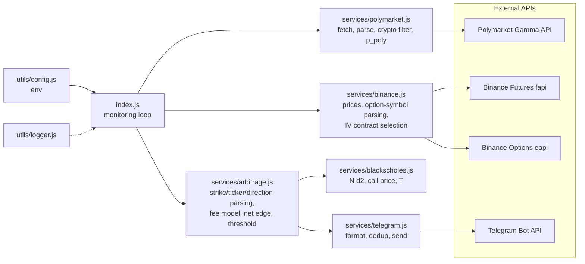

# Polymarket x Binance Mispricing Scanner

[](https://github.com/dhurvapatil/cross-platform-arbitrage-bot/actions/workflows/tests.yml)


A Node.js scanner that prices Polymarket "will BTC be above $X on date" markets as digital options using Binance options implied volatility, then sends a Telegram alert when the gap to Polymarket's price is larger than an assumed fee model. **It is an alerting tool: it does not place orders on either venue.**

## How it works

Every `CHECK_FREQUENCY_MS` the scanner runs one cycle:

1. **Polymarket** (Gamma API `/events`): fetch the 100 highest-volume open events, flatten to markets, keep crypto-related ones, and read the "Yes" price as the market-implied probability `p_poly`.
2. **Binance** (public endpoints, no keys needed):
   - USDT-perpetual last price from `fapi /ticker/price` for BTC, ETH, SOL, used as the spot proxy `S`.
   - The options mark table from `eapi /mark` (cached 60 s), which gives the mark implied volatility (`markIV`) for each listed contract.
3. **Parse** each question: ticker, strike `K` (`$120,000`, `$120k`, `$1.2m`), and direction (`above`/`reach` is bullish, `below`/`under` is bearish; ambiguous questions are skipped).
4. **Price** the question as a digital option and compare with `p_poly`.

### From a Polymarket market to a digital-option probability

"BTC above $K on date T" pays 1 if `S_T > K` and 0 otherwise, which is a cash-or-nothing digital call. Under Black-Scholes with continuous compounding at rate `r`, its risk-neutral probability of finishing in the money is

$$
p_{model} = N(d_2), \qquad d_2 = \frac{\ln(S/K) + \left(r - \tfrac{1}{2}\sigma^2\right)T}{\sigma\sqrt{T}}
$$

For a "below $K" question, `p_model = 1 - N(d_2)`.

| Symbol | Source |
|---|---|
| `S` | Binance USDT-perp last price (a spot proxy, not the settlement index) |
| `K` | Parsed from the question text |
| `T` | `(market end date - now) / 365.25 days`, floored at 1 day |
| `r` | Constant 5% (not fetched) |
| `sigma` | `markIV` of one Binance call (see below) |

`N` is the standard normal CDF, computed as `0.5 * (1 + erf(x / sqrt(2)))` with the Abramowitz-Stegun 7.1.26 erf approximation (max error about 1.5e-7). Inputs are rejected (market skipped) if `S, K, T, sigma <= 0` or `sigma > 5` (500%), which is treated as a data error.

**Volatility input.** For each market the scanner picks the Binance **call** on the same underlying that has (a) not expired, (b) expiry on or after the Polymarket end date, and (c) the lowest score `3 * |K_opt - K| / K + 0.01 * (days past the market end date)`. Its `markIV` is used as `sigma`. There is no smile interpolation: the IV of the nearest listed strike is used as is. Binance options only list a handful of underlyings, so other tickers are skipped.

### Fee model and net edge

Fee constants are hard-coded assumptions in `src/services/arbitrage.js`, expressed as a fraction of notional:

| Component | Assumed rate |
|---|---|
| Polymarket | 2.5% |
| Binance futures (round trip) | 0.04% |
| Slippage buffer | 0.10% |
| **Total** `f` | **2.64%** |

With `Delta = p_poly - p_model` and a $1,000 reference notional:

$$
\text{gross} = |\Delta| \cdot 1000, \qquad
\text{net} = |\Delta| \cdot 1000 - f \cdot 1000, \qquad
m = \frac{\text{net}}{1000} = |\Delta| - f
$$

An alert is sent when `m >= MIN_PROFIT_THRESHOLD` (the env value is a percent; `0.5` means 0.5%). With the example config, the probability gap must therefore be at least 3.14 percentage points. `Delta > 0` (Polymarket richer than the model) is labelled `SELL_POLYMARKET_YES`, otherwise `BUY_POLYMARKET_YES`. Confidence is `high` for a gap above 5 pp, `medium` above 2 pp, else `low`.

## Architecture



## Example alert

Illustrative format only, not real output:

```text
Arbitrage Alert!

Profit: 7.4%
Price: $100,000 (BTC)
Direction: SELL_POLYMARKET_YES

Polymarket: https://polymarket.com/market/<market-id>
Binance: https://www.binance.com/en/futures/BTCUSDT
```

"Profit" is the modelled net edge `m` under the assumptions above, not a realised or guaranteed return.

## Quickstart

Requires Node 20+ (CI uses 20) and a Telegram bot token and chat id (create the bot with [@BotFather](https://t.me/botfather)).

```bash
npm ci
cp config/.env.example .env     # then edit .env
npm start                       # calls live Polymarket/Binance APIs and sends real Telegram messages
```

| Variable | Meaning |
|---|---|
| `TELEGRAM_BOT_TOKEN`, `TELEGRAM_CHAT_ID` | Required |
| `BINANCE_API_KEY`, `BINANCE_API_SECRET` | Optional; only public endpoints are used today (`BINANCE_SECRET_KEY` is accepted as a legacy alias) |
| `MIN_PROFIT_THRESHOLD` | Minimum net edge in percent (default 2.0 if unset; the example file uses 0.5) |
| `CHECK_FREQUENCY_MS` | Poll interval, at least 1000 (default 30000) |
| `MARKET_FILTERS` | Parsed and logged, not yet used for filtering |
| `LOG_LEVEL`, `LOG_TO_FILE` | Logging |

`.env` is git-ignored; never commit real credentials.

## Testing

```bash
npm test          # Jest, ESM, no network
npm run coverage  # adds a coverage report
```

The suite covers: normal CDF reference values and symmetry, N(d2) and call price against textbook Black-Scholes values, monotonicity and bounds, the fee and net-edge arithmetic (including the 2.64 pp break-even), threshold filtering and sorting, strike/ticker/direction parsing (including regressions), Polymarket payload parsing, Binance option-symbol parsing and contract selection, Telegram formatting and dedup, and config handling. HTTP clients are stubbed. `scripts/` holds two manual probes (not part of the suite; `scripts/test-binance.js` hits live Binance).

## Limitations, and why these gaps are not free money

A positive modelled edge is not a profit. Specifically:

- **Fees are assumed, not measured.** The 2.64% total is a flat constant. Actual Polymarket fees, Binance fees, spreads and funding vary by market and over time, and the hedge leg is not actually modelled as a position.
- **Liquidity and depth.** `p_poly` is the quoted Yes price, not an executable price. Order-book depth, spread and the size you can actually fill are not checked; the $1,000 notional is a reference number.
- **Resolution and oracle risk.** Polymarket resolves on its own source and wording (a specific exchange or index, a time of day, tie-breaking rules). The model uses a Binance perp price and a Binance option expiring at 08:00 UTC, so basis and definition mismatches can swallow a small gap.
- **Volatility-model error.** Black-Scholes assumes lognormal returns with constant vol; crypto has fat tails and a volatility smile. Using the IV of the nearest strike, from an option that may expire later than the market, is a rough proxy. Risk-neutral probability is also not a real-world forecast, and `r` is a fixed 5%.
- **Barrier vs. terminal.** "Reach" / "hit $X by date" markets pay if the price touches `K` at any time. The scanner treats them as a terminal-date digital, which understates their probability, so some "overpriced" Polymarket readings may just be touch-vs-terminal mismatch.
- **Latency and stale data.** Polling is every 30 s by default and reads independent APIs sequentially; prices can move between reads.
- **Capital lock-up.** Capital on Polymarket is tied up until resolution, so a few-percent edge should be compared with the opportunity cost over that horizon.
- **No execution layer.** The tool only alerts. There is no order placement, position tracking, hedging or risk limit.
- **Heuristic parsing.** Ticker and direction come from keyword matching on the question text, so some wordings will be missed or misclassified (for example generic words such as "link" or "hit").

None of this has been backtested, and no historical performance is claimed. The live-API path (`fetchOptionsData` against `eapi /mark`, and the Polymarket fetch) was not exercised against the live services when this README was written; the unit tests use stubbed responses.

## Roadmap

- Paper-trading P&L log: record every alert with executable prices and mark the outcome at resolution.
- Backtest on historical Polymarket and Binance options snapshots to measure whether flagged gaps converge or merely reflect model error.
- Barrier (touch) probability for "reach" markets, and an IV smile interpolation in strike and expiry.
- Order-book aware sizing (depth and spread) instead of a flat fee constant.
- An execution layer with explicit risk limits, behind a dry-run default.

## License

MIT, see [LICENSE](LICENSE).
